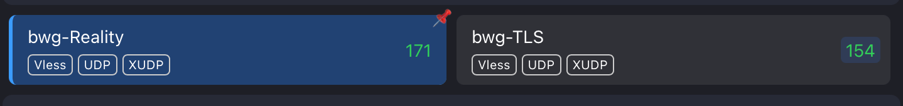
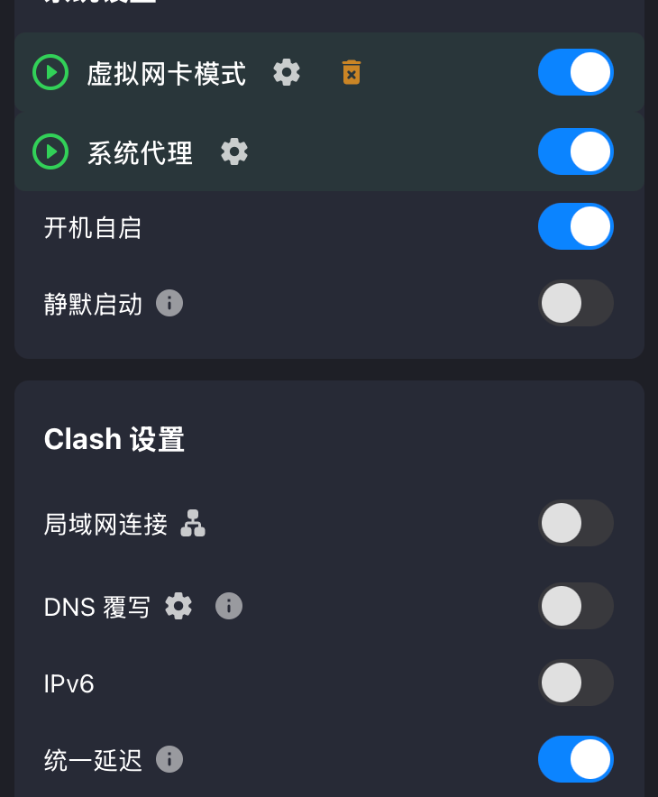

# 我是怎么搭建 Claude 使用环境的

前面折腾了好几次之后，我决定把自己的使用环境重新整理一下。这篇就记录一下，我最后用的服务器、网络配置，以及每天打开 Claude 之前会做的检查。

## 一、先准备一台 VPS

我最后选择的是一台**洛杉矶、适配 CN 线路的 VPS**，价格是 **89 美刀一个季度**。

选好服务器并完成购买之后，我把服务器相关的信息保存好，接下来就可以开始配置了。服务器地址、密码和订阅链接这些东西，自己留着就好，不要随手发给别人。

## 二、配置分流和两个出口

拿到服务器之后，我配置了对应的分流，搞了两个出口。这样后面使用的时候，就可以按照自己的需求，让不同的流量走对应的出口。

## 三、在 Clash Verge 里导入配置

服务器那边配置好之后，我把对应的配置导入 Clash Verge，然后按照下面的截图检查设置：

截图里我的设置是：

- **虚拟网卡模式（TUN 模式）**：开启。
- **系统代理**：开启。
- **开机自启**：开启；静默启动关闭。
- **局域网连接、DNS 覆写、IPv6**：关闭。
- **统一延迟**：开启。

还有一个地方要注意：点击**虚拟网卡模式旁边的设置**，进入 TUN 设置后，把**严格路由**打开。上面的截图没有展开这个设置页面，记得进去再检查一下。

这些是我自己的设置，不同版本的界面可能不一样。导入的配置和订阅链接也要自己保管好。

## 配置好了，准备开蹬

到这里，环境就配置好了。接下来按照前面的[使用前自检教程](../02-Claude使用前的环境检查教程.md)，检查一下网络和邮箱，确认没问题之后，就可以打开 Claude 桌面端开蹬了。
